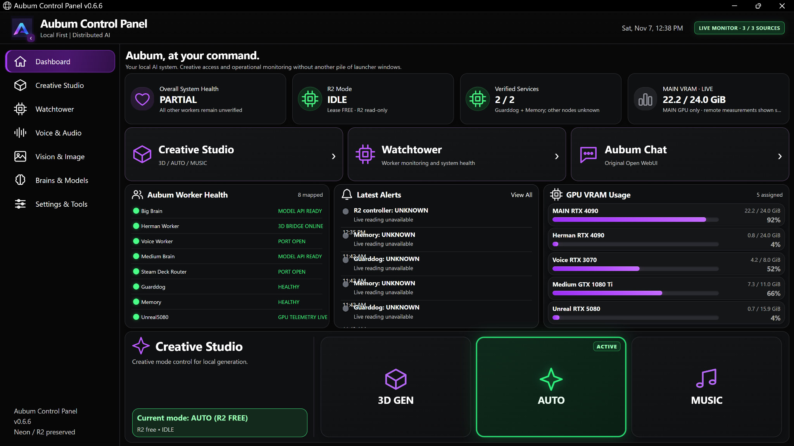
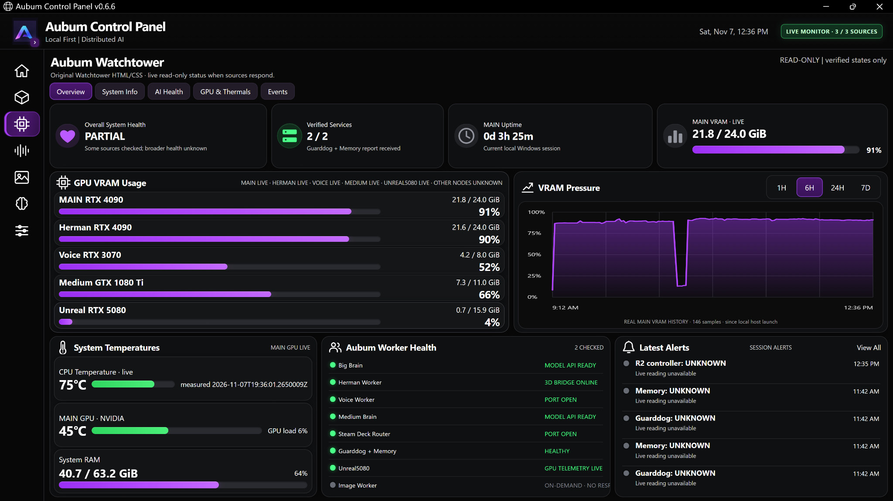
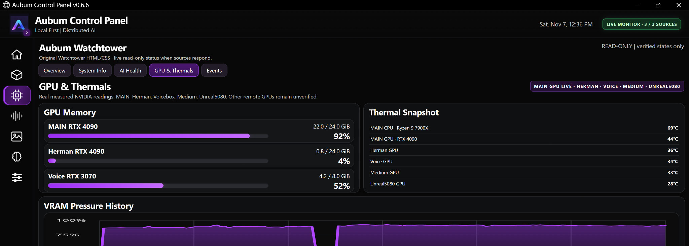
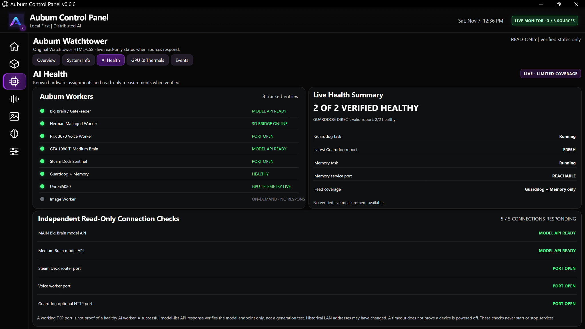
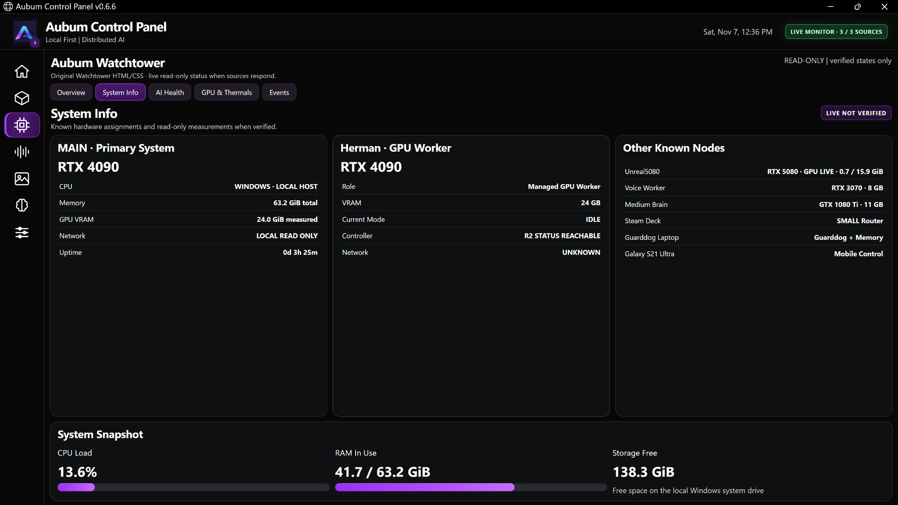

# Aubum Control Panel / Watchtower v0.6.6

**Private prototype checkpoint: November 7, 2026.** This is a sanitized public description of the existing private local-first Aubum Control Panel, not a public app release or installation guide.

## Interface tour

The supplied November 7 captures show the **Control Panel Home** and Watchtower's **Overview**, **System Info**, **AI Health**, **GPU & Thermals**, and **Events** pages. The Settings & Tools page also shows a connected existing Neon Studio controller, but paths and private connection details are intentionally not reproduced here.

- **Control Panel Home:** Creative Studio, Watchtower, and chat entry points; R2 in AUTO/IDLE in the captured session; tracked worker health, alerts, and VRAM usage.
- **Overview:** MAIN RTX 4090, Herman RTX 4090, Voicebox RTX 3070, Medium GTX 1080 Ti, and Unreal5080 RTX 5080 with live GPU VRAM readings. MAIN VRAM history, RAM, temperature and worker status panels are visible.
- **System Info:** primary and GPU-worker roles, assigned node hardware, MAIN CPU load, RAM, and system-drive free space.
- **AI Health:** tracked worker states, separate limited checks, and **2/2 verified healthy** Guarddog and Memory snapshot. A responding TCP port is not proof of successful AI inference.
- **GPU & Thermals:** five NVIDIA GPU readings and a live CPU temperature snapshot for MAIN (Ryzen 9 7900X). Temperature and VRAM observations vary with workload.
- **Events:** session timeline distinguishing AVAILABLE/HEALTHY reports and UNKNOWN readings; UNKNOWN is not proof that a node is powered off.

The **3/3 monitor sources** badge refers to the dashboard's source categories, not a pass of every distributed worker or its recovery mechanisms.

## Current checkpoint: working versus pending

| Feature | November 7 status |
| --- | --- |
| v0.6.6 dashboard UI / live readings | **WORKING in user screenshots** |
| Five GPU telemetry feeds | **LIVE in captured session** |
| MAIN CPU and GPU temperatures | **LIVE in captured session** |
| Guarddog + Memory status | **2/2 healthy in captured session**, some transient UNKNOWN events |
| Medium Brain scheduled GPU telemetry retry | **Installed and self-launched without manual start; HTTP LIVE** |
| Voicebox telemetry task boot + one-minute retry | **Installed, backed up; publisher LIVE; reboot/exit recovery not tested** |
| Unreal5080 telemetry task boot + one-minute retry | **Installed, backed up; publisher LIVE; reboot/exit recovery not tested** |
| MAIN Big Brain startup files | **Corrected on disk**, preserved production Qwen3.8 target; backup created; reboot behavior not tested |
| MAIN GPU FREE/RESTORE desktop controls | **Previously manually exercised**; dashboard release controls not verified |
| Fleet cold start after shutdown | **PENDING** |
| Unattended recovery after unexpected publisher/model exit | **NOT VERIFIED** |
| Dashboard as primary MAIN GPU release/enable control | **PLANNED**, desktop fallback retained until tests pass |

The private implementation and authenticated bridges, scripts, local IPs, access credentials, model weights, and production settings are not part of this public repository. The public project is still extracting reusable infrastructure from the private Aubum prototype.

## Screenshot selection

Five distinct, deduplicated operator screenshots were uploaded on November 7, 2026. They show the **observed private v0.6.6 prototype**, not a public installable application. Values are time-specific and some components are explicitly marked UNKNOWN or PARTIAL.

### 1. Control Panel Home

Full landing screen with worker health, R2 AUTO/IDLE status, Creative Studio selector, and multi-node GPU memory bars.

### 2. Watchtower Overview

Read-only fleet overview: GPU VRAM usage, MAIN VRAM pressure history, system temperatures, worker status, and session alerts.

### 3. GPU & Thermals

Measured NVIDIA readings across MAIN, Herman, Voicebox, Medium Brain, and Unreal5080; MAIN Ryzen CPU and GPU thermal snapshots. Cropped to leave out the still-unverified manual release controls.

### 4. AI Health

Tracked worker endpoints and the separately scoped Guarddog + Memory report. A green port check means responsive transport, not a validated model inference.

### 5. System Info

Known node roles and measured MAIN utilization, RAM and system-drive storage; network details remain appropriately obscured.

**Next acceptance test:** cold startup and health verification after full shutdown, then separate supervised tests for unexpected service failure and recovery. Only promote release/enable buttons after their safety path is actually tested. Preserve the existing desktop fallback.
